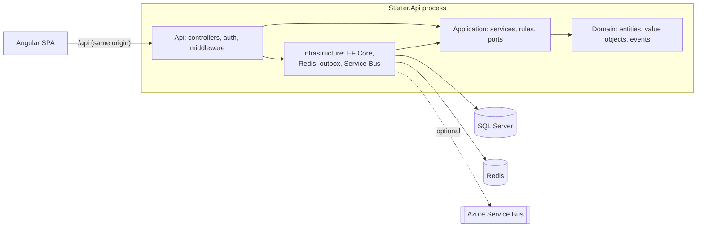

# Work Management Starter

A .NET 10 and Angular 21 starter repository built around a small work management domain:
projects, work items, comments and notifications. It is meant to be cloned and extended, and to
show the engineering decisions behind it rather than a long feature list.

The backend is a modular monolith organised with Clean Architecture. The frontend is a standalone
Angular application using Signals, RxJS and Angular Material. SQL Server, Redis and an optional
Azure Service Bus queue run locally in Docker.

## Technology stack

| Area | Choices |
| --- | --- |
| API | ASP.NET Core 10 (controllers), API versioning, OpenAPI, ProblemDetails, rate limiting, health checks |
| Data | Entity Framework Core 10, SQL Server 2022, migrations, row-version concurrency |
| Security | JWT access tokens, rotating refresh tokens in HttpOnly cookies, ASP.NET Core Identity password hasher, role and resource authorization |
| Caching | In-memory or Redis behind one small interface, with fail-open behaviour |
| Messaging | Transactional outbox, idempotent consumer, in-process dispatcher or Azure Service Bus |
| Frontend | Angular 21 (standalone, zoneless), Signals, RxJS, typed reactive forms, Angular Material, SCSS |
| Testing | xUnit v3, Testcontainers (SQL Server), WebApplicationFactory, Vitest |
| Delivery | Docker, Docker Compose, GitHub Actions, Dependabot |

## Features

- Sign-in with short-lived access tokens and refresh token rotation with reuse detection.
- Administrator-provisioned accounts with three roles: Member, Manager and Admin.
- Projects with owners, archive and restore. Archiving cancels open work in one transaction.
- Work items with priorities, due dates, assignment and a five-state workflow
  (Open, InProgress, InReview, Completed, Cancelled) enforced by the domain model.
- Comments on work items, editable only by their author.
- Search, filtering, sorting and pagination on every list.
- Optimistic concurrency: stale edits get `409 Conflict` instead of silently overwriting.
- Audit columns (created and modified, by whom and when) on business entities.
- In-app notifications created asynchronously when work is assigned.
- A dashboard whose figures are all computed from current data.

Business rules worth knowing before changing the code:

- Completed and cancelled work items are read-only until reopened.
- Work cannot move to InProgress or InReview without an assignee.
- Project owners and administrators can assign anyone; other users can only pick up unassigned work.
- Archived projects accept no new or changed work items.
- A project with work in progress or in review cannot be archived.

## Architecture



Dependencies point inwards: Domain has no package references, Application depends only on
Domain and Microsoft.Extensions abstractions, Infrastructure implements Application's interfaces,
and Api composes everything. See [docs/architecture.md](docs/architecture.md).

## Project structure

```
src/
  Starter.Domain/          Entities, value objects, domain events and business rules
  Starter.Application/     Services, DTOs, validation, repository and infrastructure interfaces
  Starter.Infrastructure/  EF Core, migrations, repositories, caching, messaging, token issuing
  Starter.Api/             Controllers, authentication, error handling, rate limiting, startup
tests/
  Starter.Domain.Tests/        Business rules, including every status transition
  Starter.Application.Tests/   Service workflows and authorization with in-memory fakes
  Starter.IntegrationTests/    HTTP and database tests against SQL Server in a container
client/                    Angular application (core, shared, features, layout)
docker/servicebus/         Queue definition for the Service Bus emulator
docs/                      Architecture notes and decision records
```

## Prerequisites

- .NET SDK 10.0
- Node.js 24 LTS with npm 11 (the lock file is maintained with npm 11; npm 10 is not supported)
- Docker with Compose v2 (needed for the full stack and for integration tests)

## Running locally

### Everything in Docker

```bash
cp .env.example .env
```

Edit `.env` and replace every value (the file explains each one), then:

```bash
docker compose up --build
```

Open http://localhost:8080. Migrations and demo data are applied on first start. Demo accounts
all use the `SEED_DEFAULT_PASSWORD` from `.env`:

| Email | Role |
| --- | --- |
| admin@kestrel-logistics.test | Admin |
| dana.reyes@kestrel-logistics.test | Manager (owns WMS and PORTAL) |
| samir.okafor@kestrel-logistics.test | Manager (owns BILL) |
| lena.fischer@kestrel-logistics.test | Member |
| tomas.ruiz@kestrel-logistics.test | Member |

The company and people are fictional.

### API and client on the host

Start only the dependencies:

```bash
docker compose up -d sqlserver redis
```

Store local settings as user secrets (never in `appsettings*.json`):

```bash
dotnet user-secrets --project src/Starter.Api set "ConnectionStrings:Database" "Server=localhost,1433;Database=Starter;User Id=sa;Password=<MSSQL_SA_PASSWORD>;TrustServerCertificate=True"
```

```bash
dotnet user-secrets --project src/Starter.Api set "Jwt:SigningKey" "$(openssl rand -base64 48)"
```

```bash
dotnet user-secrets --project src/Starter.Api set "Seed:DefaultPassword" "<at least 12 characters>"
```

Run the API (http://localhost:5080, OpenAPI document at `/openapi/v1.json` in Development):

```bash
dotnet run --project src/Starter.Api --launch-profile http
```

Run the client (http://localhost:4200, proxies `/api` to the API):

```bash
cd client && npm ci && npm start
```

In Development the API applies migrations and seeds demo data on startup.

## Configuration

Settings are bound to options classes and validated at startup, so a missing signing key or an
invalid value stops the application immediately rather than failing on first use.

| Setting | Purpose | Default |
| --- | --- | --- |
| `ConnectionStrings:Database` | SQL Server connection | required |
| `ConnectionStrings:Redis` | Redis connection, used when `Caching:Provider` is `Redis` | none |
| `Jwt:SigningKey` | HMAC key for access tokens, 32+ characters | required |
| `Jwt:Issuer`, `Jwt:Audience` | Token validation values | `starter-api`, `starter-client` |
| `Authentication:AccessTokenLifetime` | Access token lifetime | 15 minutes |
| `Authentication:RefreshTokenLifetime` | Refresh token lifetime | 7 days |
| `Caching:Provider` | `Memory` or `Redis` | `Memory` |
| `Caching:LookupExpiration` | Expiry of cached lookup lists | 10 minutes |
| `Messaging:Transport` | `InProcess` or `AzureServiceBus` | `InProcess` |
| `Messaging:ServiceBus:ConnectionString` | Service Bus connection, from secrets only | none |
| `Database:ApplyMigrationsOnStartup` | Apply migrations when the API starts | `false` (`true` in Development) |
| `Database:SeedDevelopmentData` | Seed demo data (Development environment only) | `false` (`true` in Development) |
| `RateLimiting:*` | Login and general request limits per minute | 10 and 300 |
| `Cors:AllowedOrigins` | Only needed if the SPA is served from another origin | empty |
| `ReverseProxy:TrustForwardedHeaders` | Trust `X-Forwarded-*` from a proxy in front of the API | `false` |

Environment variables use double underscores, for example `ConnectionStrings__Database`.
In Azure, the same keys map to App Service settings or Key Vault references.

## Database migrations

Migrations live in `src/Starter.Infrastructure/Persistence/Migrations`. The tool is pinned in
`dotnet-tools.json`:

```bash
dotnet tool restore
```

Add a migration after changing the model:

```bash
dotnet ef migrations add <Name> --project src/Starter.Infrastructure --startup-project src/Starter.Api --output-dir Persistence/Migrations
```

Apply migrations to a database explicitly:

```bash
dotnet ef database update --project src/Starter.Infrastructure --startup-project src/Starter.Api --connection "<connection string>"
```

For deployments, generate an idempotent script or a migration bundle and run it as a pipeline
step instead of migrating on application startup:

```bash
dotnet ef migrations script --idempotent --project src/Starter.Infrastructure --startup-project src/Starter.Api --output migrate.sql
```

See [docs/database.md](docs/database.md) for the schema and indexing decisions.

## Testing

Backend (integration tests need Docker; Testcontainers starts SQL Server automatically):

```bash
dotnet test --solution Starter.slnx
```

Frontend:

```bash
cd client && npm test -- --watch=false
```

| Suite | What it covers |
| --- | --- |
| Domain | Every status transition, closed-item rules, assignment rules, archiving, project keys, lockout, token rotation |
| Application | Authorization decisions, login and refresh flows including reuse detection, concurrency handling, notification handler |
| Integration | HTTP status codes and problem details, cookies, persistence and audit columns, database-level concurrency, archive transaction rollback, cache invalidation, outbox dispatch, duplicate and concurrent message delivery, dead-lettering, retries, rate limiting |
| Client | Token interceptor (refresh and replay, single shared refresh), guards, error mapping, components |

## Continuous integration

`.github/workflows/ci.yml` builds and tests the backend in Release, fails on vulnerable NuGet
packages, checks that the EF model has no unmigrated changes, builds and tests the client, audits
production npm dependencies, and builds both container images. Dependabot keeps NuGet, npm,
Docker and Actions dependencies current within the current major versions.

Nothing is deployed by this repository. `docs/architecture.md` describes how the containers map
onto Azure services.

## Documentation

- [Architecture](docs/architecture.md)
- [Database](docs/database.md)
- [Authentication and authorization](docs/authentication.md)
- [Caching](docs/caching.md)
- [Messaging](docs/messaging.md)
- [Architecture decision records](docs/decisions/)

## Known limitations

- Offset pagination: deep pages get slower on very large tables. Keyset pagination is the upgrade path.
- Text search uses `LIKE '%term%'`, which cannot use an index. Full-text search would be needed at scale.
- Rate limits are counted per API instance, not globally.
- With the in-memory cache, invalidation only reaches the instance that made the change. Use Redis when running more than one instance.
- Processed outbox rows and inbox records are never purged; a retention job is needed for long-running systems.
- Notifications are polled when the menu opens; there is no push channel.
- The access token signing key is symmetric. Separate token issuers and validators should use an asymmetric key.
- Dev-only npm tooling has moderate advisories (glob and minimatch in the Angular CLI) with no fix inside Angular 21. Production dependencies have none.

## Possible improvements

- Keyset pagination and SQL Server full-text search for work item lists.
- Push notifications over SignalR, backed by the existing outbox events.
- Managed identity for SQL Server and Service Bus in Azure instead of connection strings.
- OpenTelemetry tracing and metrics exported to Azure Monitor.
- Playwright end-to-end tests in CI against the Compose stack.
- An activity history per work item built from domain events.

## License

[MIT](LICENSE)
