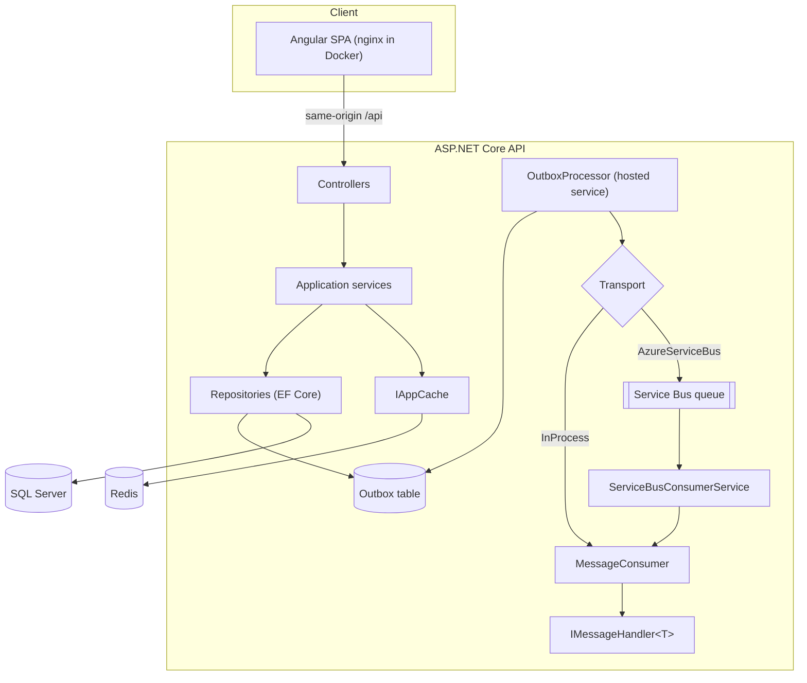
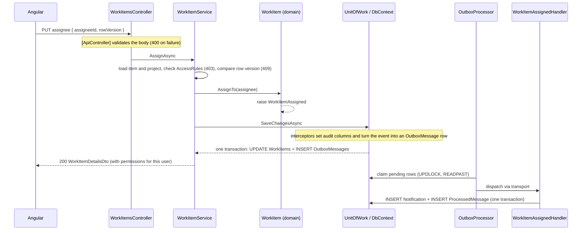

# Architecture

## Shape of the system

One deployable API process, one static web front end, SQL Server as the system of record, and
Redis and Service Bus as optional supporting services. The API is a modular monolith: feature
folders inside layered projects, not separately deployed services (see
[ADR 0004](decisions/0004-modular-monolith.md)).



## Layers

| Project | Responsibility | May reference |
| --- | --- | --- |
| `Starter.Domain` | Entities, value objects, domain events, business rules, `DomainException` | nothing |
| `Starter.Application` | Use-case services, DTOs and validation attributes, resource authorization, interfaces for persistence, caching, hashing and token issuing | Domain, `Microsoft.Extensions.*.Abstractions` |
| `Starter.Infrastructure` | EF Core `DbContext`, configurations, migrations, repositories, unit of work, caches, outbox, Service Bus, JWT issuing, password hashing | Application |
| `Starter.Api` | HTTP surface: controllers, authentication and policies, exception handling, rate limiting, versioning, OpenAPI, composition root | Infrastructure |

The rule that matters is the direction: nothing inward knows about anything outward. Domain
entities do not reference EF Core attributes; mapping lives in `Infrastructure/Persistence/Configurations`.
Application never sees `DbContext`, `HttpContext` or Redis types.

Why this layering and where it costs more than it gives: [ADR 0001](decisions/0001-clean-architecture.md).

## A request from start to finish

Assigning a work item (`PUT /api/v1/work-items/{id}/assignee`):



Failures map to RFC 9457 problem details in `ApiExceptionHandler`:

| Exception | Status | Example `code` |
| --- | --- | --- |
| Model validation | 400 | field errors in `errors` |
| `AuthenticationFailedException` | 401 | `authentication_failed` |
| `ForbiddenAccessException` | 403 | `forbidden` |
| `NotFoundException` | 404 | `not_found` |
| `ConflictException` | 409 | `project.key_taken` |
| `ConcurrencyConflictException` | 409 | `concurrency_conflict` |
| `DomainException` | 422 | `work_item.invalid_status_transition` |
| anything else | 500 | `internal_error`, details only in logs |

Every response includes `traceId`, which also appears in the structured logs.

## Application services

Each feature has an interface and one implementation (`IWorkItemService`, `WorkItemService`).
There is no mediator, no command objects and no generic handler pipeline; a controller calls a
service method and the service reads like the workflow it implements. The reasoning and the
point at which a pipeline would start to pay off are in
[ADR 0002](decisions/0002-service-based-application-logic.md).

Validation happens in two places with different jobs:

- **Request shape** (required fields, lengths, formats) uses DataAnnotations on the request
  records and is enforced automatically by `[ApiController]`, before any service code runs.
- **Business invariants** live in the domain model and throw `DomainException`. They hold no
  matter which caller invokes the domain, including the seeder and background handlers.

## Authorization

Two levels, deliberately separated:

1. **Role policies** at the controller (`Administrators`, `ProjectCreators`), plus a fallback
   policy that makes every endpoint require authentication unless marked `[AllowAnonymous]`.
2. **Resource rules** in `Application/Common/Security/AccessRules.cs`, which need the loaded
   project or work item (is the caller the owner, the reporter or the assignee?).

The same `AccessRules` methods produce the `permissions` object on `WorkItemDetailsDto` and
`canManage` on project details. The client shows or hides controls from those flags and never
re-implements the rules. Details in [authentication.md](authentication.md).

## Dependency injection and lifetimes

| Lifetime | Services | Reason |
| --- | --- | --- |
| Singleton | `TimeProvider`, `IAppCache`, `IPasswordHasher`, `IAccessTokenIssuer`, `MessageTypeRegistry`, `MessageConsumer`, `ServiceBusClient` and sender | Stateless or thread-safe and expensive to create |
| Scoped | `StarterDbContext`, repositories, `IUnitOfWork`, application services, `ICurrentUser`, EF interceptors | One unit of work per request; `DbContext` is not thread-safe |
| Hosted | `OutboxProcessor`, `ServiceBusConsumerService` | Long-running background loops |

Singletons that need scoped services (`OutboxProcessor`, `MessageConsumer`) create a scope per
batch or message through `IServiceScopeFactory`. Injecting the `DbContext` directly into them
would be a captive dependency: one context shared across threads for the life of the process.

`TimeProvider` is injected everywhere the current time matters, which is what makes lockout,
token expiry and back-off logic testable with `FakeTimeProvider`.

## Front end

```
client/src/app/
  core/            singletons: AuthService, interceptor, guards, lookup and inbox services
  shared/          presentational components, pipe, directive, API models, load-state helpers
  features/        authentication, dashboard, projects, work-items, profile, users (lazy routes)
  layout/          application shell: sidebar, toolbar, notifications and user menus
```

- Every route below the shell is lazy loaded; the initial bundle is roughly 110 kB compressed.
- Server data flows through RxJS (`switchMap` cancels superseded requests) and is exposed to
  templates as signals with `toSignal`. Local UI state is plain signals. See
  [ADR 0007](decisions/0007-signals-and-rxjs.md).
- A single `LoadState<T>` union (`loading | loaded | error`) drives loading, empty and error
  states, so a template can never show stale data next to an error.
- On the work item list the URL query string is the only source of filter state, so filtered
  views can be bookmarked, shared and linked from the dashboard.
- The app is zoneless; change detection is driven by signals and `OnPush` components.

## Running in Azure

Not deployed by this repository, but the pieces map directly:

| Container or setting | Azure service |
| --- | --- |
| API image | Azure Container Apps or App Service for Containers |
| Web image (nginx) | Same, or Azure Static Web Apps with `/api` routed to the API |
| SQL Server | Azure SQL Database (apply migrations from the pipeline with a bundle or idempotent script) |
| Redis | Azure Cache for Redis |
| Service Bus emulator | Azure Service Bus Standard (needed for duplicate detection and dead-lettering) |
| User secrets and `.env` | Key Vault references in app settings; managed identity where supported |
| `/health/live` and `/health/ready` | Container Apps liveness and readiness probes |

Settings use standard `Section__Key` environment variables, so no code changes are needed.

## Scaling out

The API holds no session state, so running several instances behind a load balancer works with
these caveats, all of which are handled or documented:

- **Cache**: switch `Caching:Provider` to `Redis` so invalidation reaches every instance.
- **Outbox**: rows are claimed with `UPDLOCK, READPAST`, so several dispatchers do not pick the
  same batch; the idempotent consumer covers anything that slips through.
- **Rate limiting**: counters are per instance. Use a gateway (Azure Front Door, API Management)
  or a Redis-backed limiter for global limits.
- **Migrations**: run once from the pipeline, not from every starting instance.
