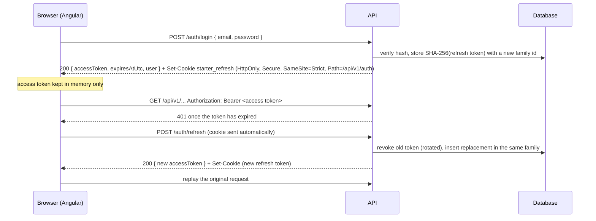

# Authentication and authorization

## Accounts

There is no public sign-up. Administrators provision accounts (`POST /api/v1/users`) with an
initial password, and users change it from their profile. This suits an internal business tool
and removes a whole class of abuse (bot registrations, email verification, enumeration through
sign-up).

Passwords:

- Hashed with ASP.NET Core Identity's `PasswordHasher<T>` (PBKDF2 with HMAC-SHA512, per-user
  salt, versioned format). `SuccessRehashNeeded` results upgrade old hashes on the next login.
  No cryptography is implemented in this repository.
- Policy: at least 12 characters and must not contain the email name. No composition rules, in
  line with NIST SP 800-63B.
- Five consecutive failures lock the account for 15 minutes.
- Changing a password revokes every refresh token of that user.

Only the hasher is taken from Identity, not `UserManager` or the Identity tables. The reasons
and the trade-offs are in [ADR 0008](decisions/0008-password-hashing-without-identity-store.md).

## Tokens

| | Access token | Refresh token |
| --- | --- | --- |
| Format | JWT, HMAC-SHA256 | 256-bit random value, opaque |
| Lifetime | 15 minutes | 7 days |
| Stored by client | JavaScript memory (a signal) | HttpOnly cookie, invisible to script |
| Stored by server | Not stored | SHA-256 hash only |
| Sent | `Authorization` header on `/api/*` only | Only to `/api/v1/auth/*` |

**Rotation and reuse detection.** Each refresh revokes the presented token and issues a new
one in the same family. If an already-rotated token is presented again, either a stolen token
is being replayed or a client is out of sync; in both cases every token in the family is
revoked and the user must sign in again. Concurrent refreshes with the same token race on the
token row (its `RevokedAtUtc` is a concurrency token), so only one can succeed.

**Logout** revokes the token family and deletes the cookie. The access token remains valid
until it expires (at most 15 minutes), which is the usual cost of stateless access tokens.

**Session restore.** After a page reload the in-memory token is gone. The app calls the refresh
endpoint once at startup (`provideAppInitializer`); a valid cookie restores the session silently.

## Why this design and what it costs

Storing the access token in `localStorage` would survive reloads without a refresh call, but any
XSS payload could read and exfiltrate it for later use. Keeping it in memory limits exposure to
what script can do while the page is open. Keeping the refresh token in an HttpOnly cookie means
script cannot read it at all.

Cookies bring CSRF into play, so the cookie is:

- `SameSite=Strict`: browsers do not attach it to requests that start on another site.
- Path-scoped to `/api/v1/auth`: it is never sent with ordinary API calls, so those calls are
  authenticated only by the bearer header, which a cross-site page cannot set.
- Only able to produce a new access token in the response body, which a cross-site page cannot read.

Trade-offs accepted:

- XSS is still serious: while the page is open, injected script can call the API as the user.
  The nginx configuration sends a strict Content Security Policy to reduce that risk, and
  Angular escapes template output by default.
- The SPA and API must share a site (same origin through the dev proxy or nginx, or sibling
  subdomains) for a `SameSite=Strict` cookie to be sent. A cross-site deployment would need
  `SameSite=None`, explicit CORS origins with credentials, and an anti-forgery token.
- Revoking a user's access is not instant: their access token works until it expires.
  Deactivating a user revokes refresh tokens immediately; shorter access lifetimes reduce the window.
- A backend-for-frontend (server-side session, no tokens in the browser) is the stronger option
  for high-risk applications. It was not chosen to keep the API usable by non-browser clients
  with the same tokens.

## Authorization

**Roles** (one per user): `Member`, `Manager`, `Admin`. They are coarse gates enforced with ASP.NET
Core policies:

| Policy | Requirement | Used for |
| --- | --- | --- |
| fallback | authenticated user | every endpoint without `[AllowAnonymous]` |
| `Administrators` | role Admin | user administration |
| `ProjectCreators` | role Admin or Manager | creating projects |

**Resource rules** depend on the specific record and are evaluated in the application services
(`AccessRules.cs`):

| Action | Allowed for |
| --- | --- |
| Edit, archive or restore a project | its owner, administrators |
| Edit a work item (title, description, priority, due date) | project owner, administrators, reporter, assignee |
| Change a work item's status | project owner, administrators, assignee |
| Assign a work item to anyone | project owner, administrators |
| Assign an unassigned work item to yourself | anyone |
| Edit a comment | its author |
| Delete a comment | its author, administrators |

The Manager role alone gives no rights inside someone else's project. Authorization is enforced
on the server for every request; the client only hides controls using the `permissions` flags
the API returns, which come from the same rules.

All authenticated users can read all projects and work items. That is a product decision for a
small internal tool; per-project membership would be the next step for larger organisations.

## Other protections

- **Rate limiting**: login is limited per client IP (10 per minute by default); everything else
  per user (or IP when anonymous). Rejections return `429` with `Retry-After`.
- **Account enumeration**: login failures return the same response, and unknown emails are
  verified against a dummy hash so response times match those of real accounts.
- **Input validation** on every request DTO; the page size is capped; sort columns are allow-listed.
- **Secrets** come from user secrets or environment variables. `Jwt:SigningKey` is validated at
  startup (minimum 32 characters), so the API refuses to start without one.
- **Forwarded headers** are trusted only when `ReverseProxy:TrustForwardedHeaders` is set, so
  clients cannot spoof their IP to dodge per-IP limits.
- **Headers**: `X-Content-Type-Options` and `Referrer-Policy` from the API; nginx adds CSP and
  frame protection for the SPA. HSTS is enabled outside Development.
